  <b>來自台灣的獨立遊戲工作室</b> · 打造打開瀏覽器就能玩的遊戲 
  免下載 · 免登入 · 支援離線遊玩

  
  

<!-- GAMES:START -->

 

## 🕹️ SELECT YOUR GAME

> 點擊封面即可直接在瀏覽器遊玩 — 免下載、免登入。

<table>
<tr>
<td width="50%" valign="top">

<h3>🎮 魔潮圍城 Hexsurge</h3>

<code>STAGE 01</code> 

<code>#彈幕</code> <code>#奇幻</code> <code>#生存</code> <code>#割草</code> 📱 行動裝置 · 📴 離線可玩 · 📲 PWA

 

</td>
<td width="50%" valign="top">

<h3>🎮 藏影迷城 HiddenShade</h3>

<code>STAGE 02</code> 迷宮型躲貓貓小遊戲

<code>#躲貓貓</code> <code>#迷宮</code> <code>#隨機生成</code> <code>#潛行</code> 🌐 多語系 · 📴 離線可玩 · 📲 PWA

 

</td>
</tr>
<tr>
<td width="50%" valign="top">

<h3>🎮 兔兔末日 Bunny Doom: Last Pomeranian</h3>

<code>STAGE 03</code> 輕鬆類打地鼠遊戲

<code>#動作</code> <code>#街機</code> <code>#打地鼠</code> 📲 PWA · ⚡ WebGPU

 

</td>
<td width="50%" valign="top">

<h3>🎮 星域防線 Starward Bastion</h3>

<code>STAGE 04</code> 網頁塔防小遊戲

<code>#策略</code> <code>#塔防</code> 📴 離線可玩

 

</td>
</tr>
<tr>
<td width="50%" valign="top">

<h3>🎮 草叢突擊 Bushwhack</h3>

<code>STAGE 05</code> 網頁射擊小遊戲

<code>#隨機生成</code> <code>#潛行</code> <code>#生存</code> <code>#射擊</code>

 

</td>
<td width="50%" valign="top">

<h3>🎮 蜂群戰線 Airhive</h3>

<code>STAGE 06</code> 小蜜蜂式網頁射擊小遊戲

<code>#街機</code> <code>#射擊</code> 📴 離線可玩 · 📲 PWA · ⚡ WebGPU

 

</td>
</tr>
<tr>
<td width="50%" valign="top">

<h3>🎮 永夜收割 Nightreap</h3>

<code>STAGE 07</code> 暗黑系割草遊戲

<code>#動作RPG</code> <code>#Boss 戰</code> <code>#暗黑奇幻</code> <code>#地城</code> 📴 離線可玩 · 📲 PWA

 

</td>
<td width="50%" valign="top">

<h3>🎮 史萊姆花園 Slimegarden</h3>

<code>STAGE 08</code> 放置類治癒小遊戲

<code>#療癒</code> <code>#收集</code> <code>#放置</code> <code>#合成</code> 📴 離線可玩 · 📲 PWA

 

</td>
</tr>
</table>

## 🛰️ BASE CAMP · 基地設施

| 倉庫 | 說明 | 網站 |
| --- | --- | --- |
| [**GameCatalog**](https://github.com/YuStellarGamesStudio/GameCatalog) | YSGS.app Gmaes Data Storages | [data.ysgs.app](https://data.ysgs.app/) |
| [**YSGS.app**](https://github.com/YuStellarGamesStudio/YSGS.app) | YSGS (星語遊戲網) – YuStellarGamesStudio's game portal. English / 繁體中文 / 日本語. Vite + TypeScript, 3D background, PWA. | [ysgs.app](https://ysgs.app/) |
| [**YuStellarGamesStudio**](https://github.com/YuStellarGamesStudio/YuStellarGamesStudio) | GitHub Profiles | [ysgs.app](https://ysgs.app/) |
<!-- GAMES:END -->

## 🧰 PLAYER GUIDE · 開發者指南

- **▶ 遊玩** — 每款遊戲都有線上版本，點擊上方封面或 PLAY 按鈕即可開始。
- **🛠️ 本機執行** — 各專案的環境需求與執行方式，請參考對應倉庫的 README。
- **🐛 回報問題** — Bug 回報與功能提案請提交至對應專案的 Issues；送出 Pull Request 前請先閱讀該專案的貢獻指南（若有）。
- **📜 授權** — 使用、修改或散布程式碼前，請確認各專案的 LICENSE。

  ── CONTINUE? ── <a href="https://ysgs.app/">Website</a> · <a href="mailto:to@yustellar.dev">Email</a>

<!-- 遊戲列表由 .github/workflows/update-profile.yml 每日自動更新，請勿手動編輯 GAMES 標記之間的內容 -->
